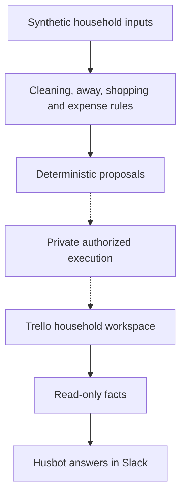

# House OS

[](https://github.com/wintersyntax/house-os-automation/actions/workflows/portfolio-ci.yml)


[](LICENSE)


**Making shared household responsibilities visible, fair and easier to coordinate.**

## The problem and idea

Cleaning rotations, shopping needs and shared expenses become hard to follow when decisions live in separate messages and people's memory. House OS uses Trello as a shared workspace, explicit rules for household decisions and a bounded Slack assistant for answers grounded in recorded facts.

## How it works

Node.js modules calculate cleaning assignments, dates and fairness adjustments; track absence; distinguish inventory needs from manual shopping items; and validate expense splits in integer øre. The private execution layer coordinates provider writes and recovery. The public edition exposes selected rules, read-only integrations, tests and offline demonstrations.



*Solid paths show public logic and read-only integration paths. Dashed paths mark the private execution boundary; offline demos use fictional inputs.*

The engineering focus is predictable behavior under duplicate events and partial failure. Money, points, identity and task completion come from deterministic rules. Optional AI wording cannot authorize a household change.

## Try the offline demos

Requires Node.js 22+, Python 3 and Git; no external accounts or npm packages.

```bash
npm run check
npm run demo:brief
npm run demo:husbot
npm run demo:failures
```

The demos show a Norwegian daily brief, a grounded shopping answer and failure recovery. Delivering the same simulated Slack event twice produces one send attempt. An uncertain send acknowledgement is kept explicit rather than blindly retried.

## Explore the implementation

- [Implementation guide](docs/IMPLEMENTATION_GUIDE.md) — source tour, examples, detailed diagrams and engineering decisions.
- [Architecture](docs/ARCHITECTURE.md) — rules, authorization and execution boundaries.
- [Implementation status](docs/IMPLEMENTATION_STATUS.md) — what is public, privately tested or still planned.
- [Demo guide](docs/DEMO.md) — supplied scenarios and limits.

## Current scope

The wider project has private test-board evidence for coordinated household workflows. This does not establish ordinary household production use. Public demos use synthetic data and perform no real Trello or Slack requests. Executing Guardian/keeper code, account configuration, personal records and private history remain excluded.

MIT — see [LICENSE](LICENSE).
