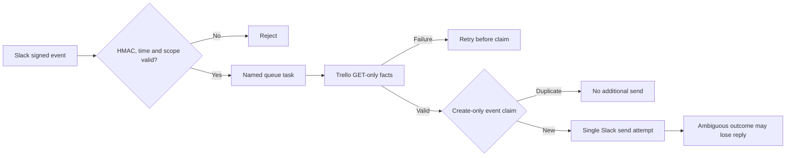

# House OS architecture

House OS coordinates household tasks through Trello state, deterministic Node.js
rules and a bounded Slack read-only assistant. The broader system includes
private Engine/Guardian orchestration and approved provider writes; this public
repository contains only a carefully bounded code slice and synthetic tests.

## Distinct paths

1. **Cleaning decisions:** `src/engine/cleaning-parity.js` computes proposals for
   room allocation, absence skips, points and dates. An allocation proposal is
   not an authorized provider action and not proof of historical Make parity.
2. **Shopping decisions:** `src/engine/shopping-rules.js` evaluates linked needs,
   checklist ticks, restocks, dismissed needs and removals. A linked checklist
   tick has a deliberately different meaning from an arbitrary manual tick.
3. **Expense decisions:** `src/engine/expense-rules.js` validates purchases and
   pant vouchers, computes amounts in integer øre and proposes settlement
   transfers. It does not read receipt images or move money.
4. **Husbot read path:** signed Slack ingress, queue handoff, strict read-only
   Trello views, deterministic reply and one create-only reply claim. The code
   demonstrates at-most-one send *attempt* per retained event claim; unknown
   provider acknowledgements may mean a reply is lost.
5. **Daily Brief:** validated fictional snapshots render Norwegian summaries;
   optional AI wording is a draft, never authority over household facts.

## Read-only Slack path

The provider adapters in the public source and local synthetic demos do not
amount to a deployed public service. Cloud IAM, provider authentication,
retention, costs, tokens and deployments must be verified independently in
private environments; none are exported here.

## Trust boundaries

- Trello remains the state source; model-generated phrasing does not set facts.
- Normalized reads, pure business rules, authorization and effect execution
  are separate responsibilities.
- Similar item names cannot prove shopping or voucher identity.
- Claims prevent duplicate send attempts, not guaranteed message delivery.
- Private test-board observations are not ordinary resident use.
