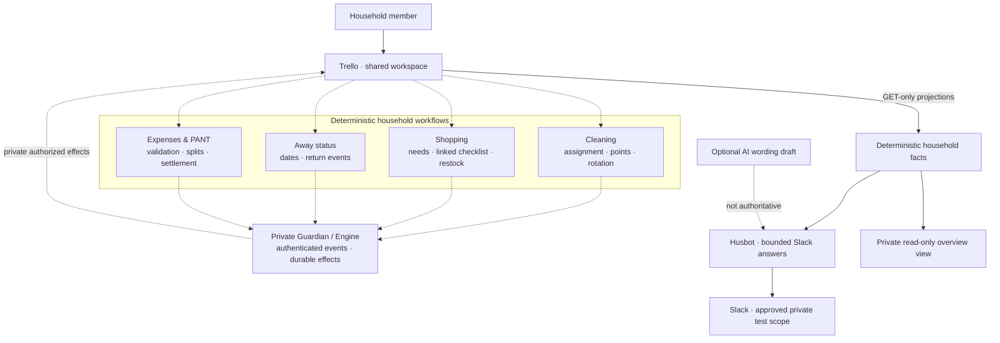
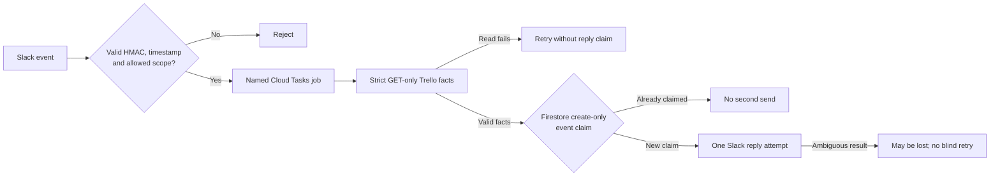

# Implementation guide

[Project overview](../README.md)

## What you can inspect

| Household workflow | What this public repository contains |
| --- | --- |
| **Cleaning & fairness** | [Six-zone rule planner](../src/engine/cleaning-parity.js) for assignments, dates, points, absence handling, room-load caps and no-completion-point handovers |
| **Away status** | [Pure `Borte til` rules](../src/engine/away-rules.js) calculate when someone is away or back and what a Norwegian status comment should say |
| **Shopping & inventory** | [Linked shopping rules](../src/engine/shopping-rules.js), [GET-only inventory projections](../src/trello/inventory.js) and [lossless list display](../src/husbot/shopping-overview.js) |
| **Expenses & PANT** | [Purchase validation and settlement proposals](../src/engine/expense-rules.js) using integer øre, vouchers and participant shares |
| **Husbot in Slack** | [Signed event intake](../src/husbot/slack-events.js), [bounded worker](../src/husbot/cloud-worker.js) and [fictional replay demo](../demos/husbot-simulation.mjs) |


The [pure handover selector](../src/engine/cleaning-handover-rules.js) identifies
open rooms due during an absence. The planner proposes a new assignment without
booking completion points; these functions do not execute provider writes.

## Architecture at a glance

The dashed connections are **proposals and private execution boundaries**, not live writes from this public export. The public code can be tested with synthetic inputs without accessing any household accounts.



**Read this as a system map, not a deployment diagram.** The rule modules and read-only Husbot source are present here; the Guardian, executing keepers, operational integrations and Power-Up are excluded. Some integrated paths have been observed on a private **test board**, while other paths remain fixture-tested or planned. AI wording never authorizes money, scores, inventory changes or task completion.

### Why the boundaries matter

The user interface is simple, but the failure modes are not. A duplicate webhook must not book cleaning points twice. A guessed checklist match must not restock the wrong product. A bot must not treat a missing receipt as a valid purchase. House OS separates **fact extraction**, **deterministic decisions**, **authorization**, **effect execution** and **readback/recovery**, with different levels of evidence for each step.

The [architecture notes](../docs/ARCHITECTURE.md) explain what the exported modules actually enforce and where the private execution boundary begins.


## Five-minute technical walkthrough

The public edition requires **Node.js 22+**, **Python 3** and **Git**. It has **no third-party npm dependencies**. The checks use fictional identities, mocked providers and local loopback tests; no Trello, Slack or Google Cloud credentials are required.

```bash
git clone https://github.com/wintersyntax/house-os-automation.git
cd house-os-automation

npm run check          # Source tests, release scanner and offline simulations
npm run demo:brief     # Norwegian Daily Brief from a fictional snapshot
npm run demo:after     # The fictional after-purchase snapshot
npm run demo:husbot    # Shopping answer + duplicate event delivery
npm run demo:failures  # Read outage and ambiguous send acknowledgement
```

`npm run check` validates the **current working tree**. For a separate audit of locally reachable Git history, including deleted blobs and commit metadata, run `npm run check:history` after fetching all relevant refs. The scanner is a safety aid, not a replacement for human review.

### Example: a grounded shopping answer

The existing [Husbot simulation](../demos/husbot-simulation.mjs) loads an in-memory snapshot with a fictional inventory need and a separate manually entered checklist item. Its output includes:

```text
🛒 Må kjøpes (2):
• Fictional flowers — HANDLELISTE
• Fictional coffee — KJØP

Same event delivered twice; only one simulated Slack reply.
```

`HANDLELISTE` and `KJØP` are **different evidence sources**. Two similar names cannot establish that two records represent the same product; a checked, unlinked entry cannot prove payment or restocking. The demo sends **no real Slack message** and makes **no real Trello request**.

### Example: the failure is part of the demonstration

The existing [failure-mode simulation](../demos/failure-modes.mjs) asserts the following behavior:

```text
Read failed → 503; no claim created.
Read recovered; claim created; send acknowledgement ambiguous → 503.
Repeated event → 204 duplicate; no second send attempt.
```

A failed read remains retryable because no reply claim was consumed. But after the worker claims an event, an ambiguous Slack send result is **not automatically replayed**. That is *at-most-once send attempts*, not exactly-once delivery and not a guarantee that the message arrived.

The [offline demo guide](../docs/DEMO.md) describes the supplied scenarios and their limitations.


## Public source vs. private operation

The wider project has been exercised through attended **private test-board** cycles covering cleaning routines, shopping-list coordination, expense/PANT bookkeeping and an overview interface. These observations are **not** evidence of routine household production use.

This public repository is a **curated, offline-testable export of real source code**, not a mirror of the private repository. It contains pure rule modules, read-only Trello/Husbot integrations, tests and fictional demos. Executing Guardian/keeper code, credentials, provider IDs, real household records, private configuration and Git history are excluded.


## The product in practice

Picture three ordinary household events:

- **A room is cleaned.** The correct assignee checks the Trello task. The private Guardian verifies who completed it, protects against guest or accidental completion, and coordinates the cleaning cycle. A deterministic plan controls points, dates and the next assignment; the model does not invent those facts.
- **A product runs out.** An inventory card marked `KJØP` becomes a linked item on the shared `Neste handletur` checklist. Under the shopping V1 contract, ticking a linked item means “bought and at home”; a separate manual checklist entry does not silently become an inventory transaction.
- **Someone buys shared supplies.** A purchase records a total, receipt presence, participants and optional `PANT` vouchers. Deterministic rules calculate amounts in **integer øre**, split the net expense and propose a monthly settlement. No bank transfer is executed.

The public repository lets you inspect and test the rules underlying these examples. The coordinated provider writes and durable production-style recovery mechanisms remain **private**.


## What is implemented

| Product area | What the public code demonstrates | Private project / boundary |
| --- | --- | --- |
| **Cleaning & fairness** | [Six-zone planner](../src/engine/cleaning-parity.js): points, dates, absence handling, balance correction and room-load caps | Attended test-board cycles and a protected Guardian have been observed privately; **this export does not execute Trello writes** |
| **Away status** | [Pure `Borte til` planner](../src/engine/away-rules.js) and [synthetic tests](../tests/away-rules-public.test.js) for status, inclusive dates and returns | The private test board has its own writer; **the public edition does not update resident profiles** |
| **Inventory & shopping** | [GET-only Trello projections](../src/trello/inventory.js), [lossless shopping display](../src/husbot/shopping-overview.js) and [shopping state rules](../src/engine/shopping-rules.js) | Private shopping keeper has had attended add/restock/removal checks; the public planner returns proposed effects only |
| **Expenses & PANT** | [Purchase and voucher validation](../src/engine/expense-rules.js), exact NOK arithmetic, participant shares, Norwegian comment text and settlement proposals | Private expense workflow has attended test-board evidence; the public edition has **no receipt interpretation, registration writer or payment execution** |
| **Husbot in Slack** | [Signed event ingress](../src/husbot/slack-events.js), [task/claim adapters](../src/husbot/cloud-platform.js), [deterministic worker](../src/husbot/cloud-worker.js) and fictional replay demos | A limited read-only reply path has been observed in an approved private test channel; **deployment configuration is not published** |
| **Daily Brief** | [Validated household facts](../src/husbot/facts.js), [Norwegian formatting](../src/husbot/daily-brief.js) and offline snapshots | Demonstration only; not a scheduled real-household brief |
| **Overview & monitoring** | Public documentation of the design boundary | Private test-board overview card, read-only Power-Up and scheduled monitoring are **not part of this source export** |
| **Maintenance & sensors** | Product roadmap | Future work / research, not a shipped integration |

The public implementation and private observations are deliberately kept separate. See [implementation status](../docs/IMPLEMENTATION_STATUS.md).


## Inside Husbot — authenticated, read-first, claim-second



This is the architecture represented by the [signed ingress](../src/husbot/slack-events.js), [worker](../src/husbot/cloud-worker.js), [cloud adapter](../src/husbot/cloud-platform.js) and mocked tests. It is **not** a claim of an independently deployed service from this public repository. The real security of cloud IAM, tokens, retention and provider scopes requires separate private operational verification.


## Engineering decisions worth inspecting

- **Domain logic is pure:** Cleaning, Shopping and Expense modules validate explicit inputs and return proposals without touching Trello, Slack, Cloud or Firestore. They can be tested with synthetic fixtures.
- **One source of truth, no guessed matches:** inventory needs, manually entered shopping items, voucher links and resident attribution have separate meanings. Text similarity is not permission to mutate state.
- **Failure is explicit:** malformed data, missing identity, uncertain provider outcomes and duplicate events are not silently treated as success.
- **Safe replay is designed, not assumed:** stable event identity, a create-only reply claim and read-before-claim ordering bound one kind of duplicate effect. They do not prove exactly-once semantics for every external API.
- **Exact money arithmetic:** the Expenses rule module works in integer øre, validates vouchers before deductions and produces deterministic *proposed* transfers, never bank transactions.
- **AI is outside the authority path:** an [optional draft adapter](../src/husbot/openrouter-draft.js) can assist with wording, but cannot alter a validated household fact or authorize a business write.
- **Reproducible public verification:** source tests, offline simulations and [independent portfolio CI](https://github.com/wintersyntax/house-os-automation/actions/workflows/portfolio-ci.yml) run without access to the private project.

## What is public — and what deliberately stays private

| Included here | Not included here |
| --- | --- |
| Real reviewed source for read-only Trello/Husbot integrations | Live household board, resident records, receipts or provider IDs |
| Pure Cleaning, Away, Shopping and Expenses rules with tests | Executing Guardian/Engine/keeper code and private runbooks |
| Fictional snapshots and in-memory success/failure simulations | Credentials, cloud configuration, IAM bindings or private runner infrastructure |
| Public CI, release scanner and readable architecture notes | Private Git history, deployment records or actual operational state |

This is a **selective public mirror snapshot**, rebuilt from reviewed files rather than by copying the private repository wholesale. Excluding private systems is part of the engineering boundary, not an indication that the public code is merely pseudocode. Sensitive material must be removed **before** any new source is exported; the private repository's Git history must never be grafted into this one.


## Repository layout

```text
src/engine/     Pure Cleaning, Away, Shopping and Expense decisions
src/husbot/     Signed Slack ingress, facts, replies and queue/claim adapters
src/trello/     GET-only inventory and shopping-list projections
tests/         Fictional unit/integration tests and scanner regressions
demos/         In-memory Husbot and failure/replay demonstrations
examples/      Fictional household snapshots
scripts/       Daily Brief preview and public-release safety checks
docs/          Architecture, roadmap, demo guide and evidence boundaries
.github/       Separate public portfolio CI
```


## Documentation and project direction

[Architecture](../docs/ARCHITECTURE.md) · [Implementation status](../docs/IMPLEMENTATION_STATUS.md) · [Demo guide](../docs/DEMO.md) · [AI boundaries](../docs/AI_SAFETY.md) · [Roadmap](../docs/ROADMAP.md)

The project combines human-directed workflow design and verification with AI-assisted coding. The aim is **dependable household coordination with explicit trust boundaries**, not an autonomous assistant permitted to change money, assignments or inventories because its output sounds convincing.

**Status:** actively developed. The public portfolio edition is runnable offline; the broader product has private attended **test-environment** evidence, not verified ordinary household-wide use.

Released under the [MIT License](../LICENSE).
